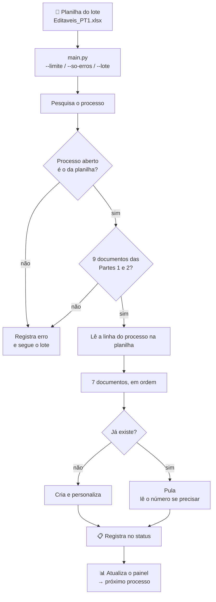
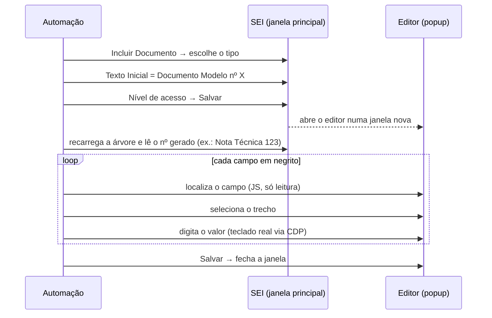

<div align="center">

# 📝 Automação SEI — Parte 3: Documentos Nativos Personalizados

**Cria 7 documentos por processo no SEI, a maioria escrita no próprio editor do sistema e preenchida com os dados de cada pessoa a partir de uma planilha, em lotes de centenas de processos.**

[](https://www.python.org/)
[](https://playwright.dev/python/)
[](https://pandas.pydata.org/)


**Série:** [Parte 1: Criação de processos](https://github.com/ThiagoDionisio05/sei-automacao) •
[Parte 2: Documentos pessoais](https://github.com/ThiagoDionisio05/sei-automacao-pt2) •
**Parte 3: Documentos nativos personalizados**

</div>

---

## 📌 Visão geral

Depois que as Partes [1](https://github.com/ThiagoDionisio05/sei-automacao) e
[2](https://github.com/ThiagoDionisio05/sei-automacao-pt2) montam o processo,
faltam os documentos que **precisam ser escritos para cada pessoa**:
requerimento, checklist, nota técnica, termo e despacho, com nome, matrícula,
valores, competências e números de outros documentos.

Este é o passo mais difícil de automatizar. A maioria desses documentos é
**nativa do SEI**: não é um PDF anexado, é texto escrito num editor rico
(CKEditor) que abre numa janela separada.

| # | Documento | Tipo | Como é criado |
|---|---|---|---|
| 1 | Requerimento de Rec. e Pagamento de DEA (RPDEA) | Nativo | Modelo + personalização |
| 2 | Checklist da Composição Processual | Nativo | Modelo + personalização |
| 3 | Nota Técnica | Nativo | Modelo + personalização + **o próprio número** |
| 4 | Anexo: Ateste Orçamentário | Externo | Anexa PDF (Público) |
| 5 | Termo de Despesas de Exercícios Anteriores (TDEA) | Nativo | Modelo + personalização + **o próprio número** |
| 6 | Comprovante de Cadastro SIAPE | Externo | Registro sem anexo (Restrito) |
| 7 | Despacho | Nativo | Modelo + personalização, **citando a Nota e o Termo** |

### Destaques

| | |
|---|---|
| ✍️ **Preenche documentos dentro do editor do SEI** | Troca cada campo marcado em **negrito** pelo valor da planilha, mantendo a formatação |
| 🔗 **Encadeia documentos** | O número que o SEI gera para a Nota Técnica e para o Termo entra automaticamente no Despacho |
| 🧷 **Trava de segurança** | Só começa se os 9 documentos das Partes 1 e 2 estiverem no processo, e se o processo aberto for mesmo o da planilha |
| ♻️ **Retomável** | Pula o que já existe, mas **não** pula um documento que ficou pela metade numa tentativa anterior |
| 🎛️ **CLI para lotes** | `--limite`, `--so-erros` e `--lote` para rodar em partes e reprocessar só as falhas |
| 📊 **Painel por lote** | HTML com a situação de cada um dos 7 documentos por processo |

---

## ⚙️ Como funciona



### Dentro de um documento nativo



---

## 🧠 Decisões técnicas

<details>
<summary><b>1. Por que digitar com o teclado em vez de alterar o texto via JavaScript</b></summary>

<br>

Esta foi a parte mais difícil do projeto. Duas abordagens diretas **não
funcionaram**:

1. **`elemento.textContent = valor`**: o CKEditor mantém o próprio modelo do
   documento e redesenha a tela a partir dele. A mudança aparecia e era
   desfeita no redesenho seguinte.
2. **`document.execCommand('insertText')`**: em teoria dispara os eventos
   certos, mas não teve efeito, provavelmente porque a janela do editor não
   tinha o foco do sistema operacional.

A solução foi dividir o trabalho:

- **JavaScript só para localizar e selecionar**: um script percorre o DOM,
  acha o campo e posiciona a seleção (`Range`) exatamente sobre ele, **sem
  alterar o texto**;
- **Playwright para digitar**: `page.keyboard.type()` envia eventos de teclado
  reais via CDP, exatamente como uma pessoa faria. O editor registra a
  mudança, e o texto digitado herda o negrito do trecho selecionado.

Veja [`personalizar_documento.py`](src/personalizar_documento.py), que
documenta esse histórico no próprio código.

</details>

<details>
<summary><b>2. Negrito como marcador de campo</b></summary>

<br>

Os modelos já existiam no SEI e foram preparados com cada campo variável em
**negrito** (por exemplo, **Nome**, **Matricula**, **Valor_numerico**). Em vez
de exigir que alguém reescrevesse tudo com `{{chaves}}`, a automação usa o
negrito como marcador:

- detecta negrito pelo **estilo computado** (`getComputedStyle().fontWeight >= 600`),
  e não pela tag. Assim cobre `<b>`, `<strong>` e `style="font-weight"`;
- funciona com o campo **sozinho** num elemento ou como **trecho** de um bloco
  maior (`NOTA TÉCNICA Nº NUMERO_NOTA/2026/UNIDADE`);
- compara nomes sem acento e sem diferenciar maiúsculas (`Lotação ` na
  planilha = `Lotacao` no documento);
- refaz a busca **a cada substituição**, porque digitar muda o DOM e
  invalidaria posições calculadas antes.

</details>

<details>
<summary><b>3. Documentos que citam o próprio número</b></summary>

<br>

Uma Nota Técnica precisa citar o próprio número sequencial (por exemplo,
"Nota Técnica 123"), mas esse número **só existe depois** que o SEI cria o
documento. A automação:

1. salva o documento, o que abre o editor;
2. recarrega a árvore na janela principal e lê o número com uma regex
   (`Nota Técnica\s+(\d+)`);
3. usa esse número ao personalizar o **mesmo** documento;
4. guarda o número para o **Despacho**, criado depois, que cita a Nota e o Termo.

Se o documento já existia de uma execução anterior, o número é lido da árvore,
e o encadeamento continua funcionando.

</details>

<details>
<summary><b>4. Idempotência que não esconde problemas</b></summary>

<br>

Pular um documento que já está na árvore evita duplicação, mas e se a
tentativa anterior **criou o documento e caiu antes de personalizar**? Ele
estaria na árvore, só que vazio. Por isso, antes de pular,
[`main.py`](main.py) consulta o status:

- se já existe e a última tentativa **deu certo**, pula (`ja_existia`);
- se já existe e a última tentativa **falhou**, para e pede revisão manual.

Tipos genéricos como "Despacho" e "Nota Técnica" colidiriam com documentos da
Parte 1 ("Despacho-Plano de Trabalho..."). Para eles, a checagem exige o
formato `tipo + espaço + número`.

</details>

<details>
<summary><b>5. Iframes que "morrem" no meio do caminho</b></summary>

<br>

Marcar certas opções no SEI dispara um *postback* que **recarrega o iframe**.
Um `Frame` obtido antes disso fica *detached*, e qualquer uso dele quebra. A
regra adotada em [`documentos_nativos.py`](src/documentos_nativos.py) é passar
a `page` adiante e buscar o frame **de novo** depois de cada ação que recarrega
a tela, com uma nova tentativa automática nos pontos instáveis.

</details>

<details>
<summary><b>6. Dados da planilha prontos para o documento</b></summary>

<br>

[`planilha.py`](src/planilha.py) prepara os valores antes de usá-los:

- remove o `R$` de `Valor_numerico` (o modelo já tem "R$" fixo, e sem isso
  sairia "R$ R$ 57,50");
- junta `Competencia_1`, `Competencia_2`... em ordem **numérica** (não
  alfabética) e formata como `outubro/2020`;
- recusa processo duplicado na planilha, em vez de escolher uma das linhas
  sem avisar.

</details>

---

## 🚀 Como rodar

### Pré-requisitos

- Python 3.10+, Google Chrome e acesso a uma instância do SEI
- Processos completos nas [Partes 1](https://github.com/ThiagoDionisio05/sei-automacao) e [2](https://github.com/ThiagoDionisio05/sei-automacao-pt2)
- Documentos Modelo cadastrados no SEI, com os campos variáveis em **negrito**

### 1. Instalação

```powershell
git clone https://github.com/ThiagoDionisio05/sei-automacao-pt3.git
cd sei-automacao-pt3
python -m venv .venv
.venv\Scripts\activate
pip install -r requirements.txt
playwright install chromium
copy src\config_local.example.py src\config_local.py   # URL do SEI e nº dos Documentos Modelo
```

### 2. Dados

- `data/Editaveis_PT1.xlsx`: uma linha por processo, com a coluna
  `Processo_SEI` e uma coluna para cada campo em negrito dos modelos.
- `src/PDFs/Anexo_Ateste_Orcamentario.pdf`: o PDF anexado no documento 4.

Alguns campos são preenchidos **automaticamente**, sem coluna na planilha:
`Processo_sei`, `data_hoje`, `Data_extenso`, `Mes_ano`, `NUMERO_NOTA` e
`Numero_termo`.

### 3. Abra o Chrome com depuração remota e faça login no SEI

```powershell
& "C:\Program Files\Google\Chrome\Application\chrome.exe" `
  --remote-debugging-port=9222 `
  --remote-debugging-address=127.0.0.1 `
  --user-data-dir="C:\ChromeSEIAutomacao"
```

> [!WARNING]
> A porta 9222 não tem autenticação. Abra essa janela **só durante a
> execução** e feche-a ao terminar.

### 4. Execute

| Comando | O que faz |
|---|---|
| `python main.py --numero <processo>` | Roda só um processo (ou vários, separados por espaço) |
| `python main.py --limite 5` | Os próximos 5 processos ainda não concluídos |
| `python main.py --so-erros` | Só os processos que falharam antes |
| `python main.py --lote PT4 --limite 2` | Usa `data/Editaveis_PT4.xlsx` e o painel desse lote |
| `python -m src.testar_personalizacao --numero <processo>` | Testa a personalização **sem salvar** e tira um print |
| `python -m src.verificar_documentos_anteriores --numero <processo>` | Confere as Partes 1 e 2 |
| `python -m src.gerar_painel [--lote PT4]` | Regera o painel do lote |

> [!NOTE]
> A automação **nunca assina documentos**. A assinatura é sempre manual.

---

## 📁 Estrutura do projeto

```
sei-automacao-pt3/
├── main.py                          # Orquestrador: lote, travas, 7 documentos, status, painel
├── requirements.txt
└── src/
    ├── config.py                    # Caminhos, travas, Documentos Modelo, lote ativo
    ├── config_local.example.py      # Modelo para os dados reais (não versionados)
    ├── browser.py                   # Conexão com o Chrome via CDP
    ├── sei_page.py                  # Helpers: frames, pesquisa, árvore, números, janelas
    ├── planilha.py                  # Lê a planilha e prepara os valores
    ├── campos_automaticos.py        # Datas por extenso e competências
    ├── documentos_nativos.py        # Incluir Documento → tipo → Documento Modelo
    ├── incluir_documento_nativo.py  # Fluxo completo de um documento nativo
    ├── personalizar_documento.py    # Substituição dos campos em negrito no CKEditor
    ├── documento_externo.py         # Documento externo (com ou sem anexo)
    ├── verificar_documentos_anteriores.py  # Trava: Partes 1 e 2 completas?
    ├── status_processos.py          # Registro por processo e por documento
    ├── gerar_painel.py              # Painel HTML por lote
    ├── atualizar_pat.py             # (em desenvolvimento) PAT em "Observações"
    ├── incluir_ateste_orcamentario.py  # Script avulso: documento 4
    ├── incluir_comprovante_siape.py    # Script avulso: documento 6
    └── testar_personalizacao.py     # Teste da personalização sem salvar
```

---

## 📚 O que aprendi

- **Editores ricos têm o próprio modelo de dados**: mexer no DOM não basta,
  é preciso passar pelos eventos que o editor escuta.
- **Dividir responsabilidades entre JS e Playwright**: JavaScript para ler e
  posicionar, eventos reais para alterar.
- **Dependências entre etapas**: um documento que precisa de um número que
  só existe depois que outro é criado.
- **Idempotência com cuidado**: "já existe" não quer dizer "está certo".
- **Ferramentas para operar lotes**: reprocessar só o que falhou vale mais do
  que rodar tudo de novo.

---

## ⚠️ Aviso

Projeto independente, criado para uso pessoal e fins de estudo. **Não é
afiliado nem endossado** por nenhum órgão público ou pelos mantenedores do SEI.
Use apenas em sistemas aos quais você tem acesso autorizado e de acordo com as
políticas da sua instituição. Nenhum dado pessoal real faz parte deste
repositório. Números de processo e de documento citados são fictícios.

Código disponibilizado apenas para consulta, como portfólio. Nenhuma licença de uso é concedida.

<div align="center">

Feito por **Thiago Dionisio** · [GitHub](https://github.com/ThiagoDionisio05)

</div>
